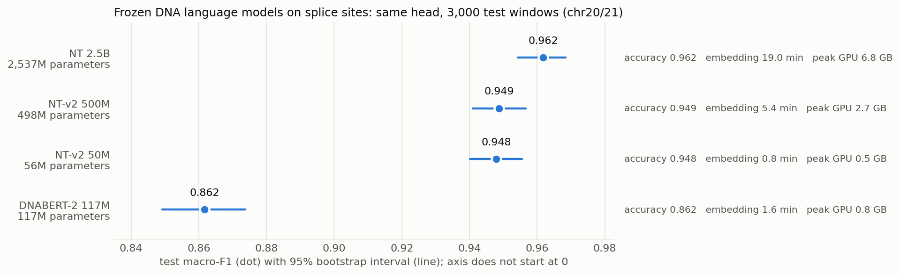
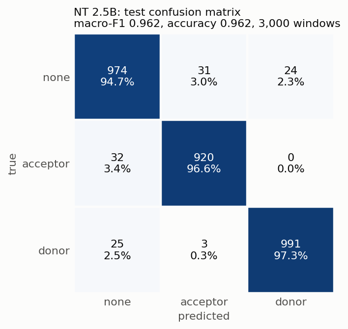
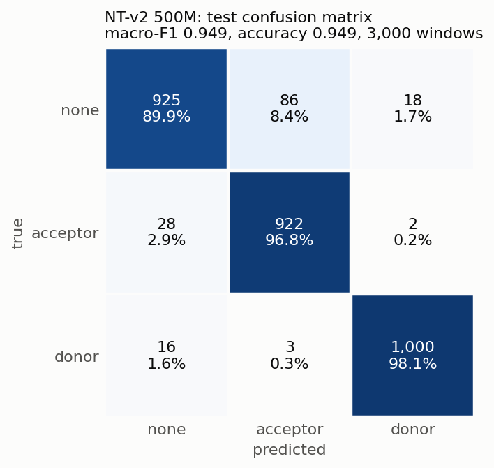
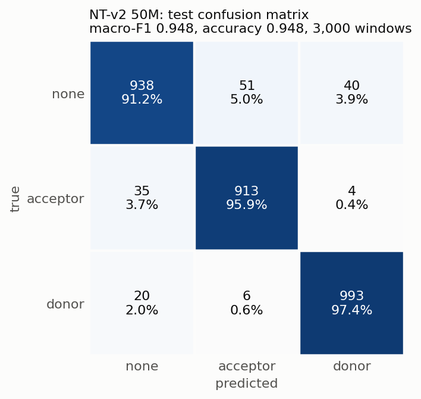
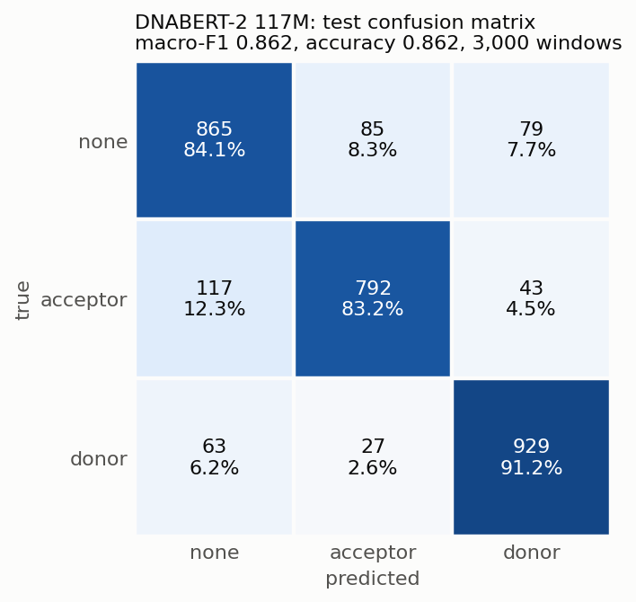

# Frozen DNA language models on splice sites (Kaggle run)

_Numbers from `results.json` (written by `kaggle/compare_models.ipynb`, full run on a Tesla T4, 33 min in total)._

Same data, same features, same head for every model: `splice_sites_all`, 30,000 training windows (chr1-19, X, Y; 27,000 to fit, 3,000 validation) and 3,000 test windows (chr20/21). The models are frozen. Each window is turned into the last-layer vector of the token covering base 300 joined with the token before it, and the 03 head (input → 256 → ReLU → Dropout 0.2 → 3, Adam 1e-3, early stopping on validation loss) is trained on that, seed 0.

| model | parameters | macro-F1 | 95% CI | accuracy | difference vs NT-v2 50M | 95% CI of the difference |
|---|---:|---:|---|---:|---:|---|
| **NT 2.5B** | 2,537M | **0.9618** | [0.9543, 0.9684] | 0.9617 | **+0.0139** | [+0.0059, +0.0224] |
| NT-v2 500M | 498M | 0.9487 | [0.9409, 0.9566] | 0.9490 | +0.0008 | [-0.0073, +0.0083] |
| NT-v2 50M | 56M | 0.9479 | [0.9401, 0.9555] | 0.9480 | reference |  |
| DNABERT-2 117M | 117M | 0.8617 | [0.8492, 0.8737] | 0.8620 | -0.0862 | [-0.1005, -0.0724] |

**Key result.** NT 2.5B reaches macro-F1 0.9618 [0.9543, 0.9684], +0.0139 over NT-v2 50M with a 95% interval of [+0.0059, +0.0224]. The interval does not include 0, so the gain is real on this test set. NT-v2 500M is no better than the 50M (+0.0008, interval includes 0), and DNABERT-2 is clearly worse (-0.0862).

How the intervals were made: 2,000 bootstrap redraws of the test windows, the same redraws for every model, so the difference interval is paired. Windows from the same gene are not independent, so these window-level intervals may be somewhat too narrow.

## Per class (test)

| model | none precision | none recall | acceptor precision | acceptor recall | donor precision | donor recall |
|---|---:|---:|---:|---:|---:|---:|
| NT 2.5B | 0.945 | 0.947 | 0.964 | 0.966 | 0.976 | 0.973 |
| NT-v2 500M | 0.955 | 0.899 | 0.912 | 0.969 | 0.980 | 0.981 |
| NT-v2 50M | 0.945 | 0.912 | 0.941 | 0.959 | 0.958 | 0.975 |
| DNABERT-2 117M | 0.828 | 0.841 | 0.876 | 0.832 | 0.884 | 0.912 |

## Confusion matrices (test; rows = true label, columns = predicted)

**NT 2.5B** (macro-F1 0.9618)

| true \ predicted | none | acceptor | donor |
|---|---:|---:|---:|
| none | 974 | 31 | 24 |
| acceptor | 32 | 920 | 0 |
| donor | 25 | 3 | 991 |

**NT-v2 500M** (macro-F1 0.9487)

| true \ predicted | none | acceptor | donor |
|---|---:|---:|---:|
| none | 925 | 86 | 18 |
| acceptor | 28 | 922 | 2 |
| donor | 16 | 3 | 1,000 |

**NT-v2 50M** (macro-F1 0.9479)

| true \ predicted | none | acceptor | donor |
|---|---:|---:|---:|
| none | 938 | 51 | 40 |
| acceptor | 35 | 913 | 4 |
| donor | 20 | 6 | 993 |

**DNABERT-2 117M** (macro-F1 0.8617)

| true \ predicted | none | acceptor | donor |
|---|---:|---:|---:|
| none | 865 | 85 | 79 |
| acceptor | 117 | 792 | 43 |
| donor | 63 | 27 | 929 |

## Run details

| model | precision on the GPU | embedding | peak GPU memory | head best epoch / epochs run |
|---|---|---:|---:|---:|
| NT-v2 50M | fp32 weights + fp16 autocast | 0.8 min | 0.5 GB | 1 / 21 |
| DNABERT-2 117M | fp32 weights + fp16 autocast | 1.6 min | 0.8 GB | 2 / 22 |
| NT-v2 500M | fp32 weights + fp16 autocast | 5.4 min | 2.7 GB | 1 / 21 |
| NT 2.5B | fp16 weights + fp16 autocast | 19.0 min | 6.8 GB | 1 / 21 |

Versions: torch 2.11.0+cu130, transformers 4.49.0, scikit-learn 1.6.1; dataset revision `851f9946252e`. Model revisions are pinned in `results.json`.

Files: `results.json` (every number, per-epoch head training history), `figures/`, and `predictions/<model>.npz` (test labels, predictions and dataset row of each test window). The trained heads (`predictions/*_head.pt`) stay on the laptop.
