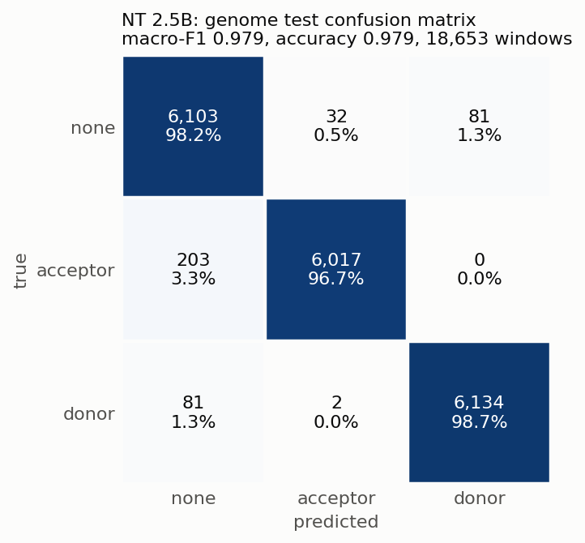
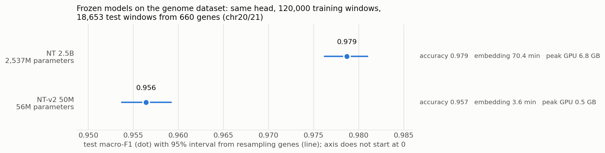

# NT 2.5B vs NT-v2 50M on the genome-wide splice-site dataset

_Numbers from `results.json`, written by `kaggle/genome_nt2500m.ipynb` on Tesla T4 (85 min in total)._

Frozen models, the same features (centre token + previous token) and the same 03 head for both. Train: 120,000 windows (every chromosome except chr20/21; 108,000 to fit, 12,000 validation). Test: 18,653 windows on chr20/21 from 660 genes. 95% intervals: 2,000 redraws of the test genes, the same redraws for both models.

| model | macro-F1 | 95% CI (genes) | accuracy | difference vs NT-v2 50M | 95% CI of the difference |
|---|---:|---|---:|---:|---|
| NT 2.5B | 0.9787 | [0.9762, 0.9810] | 0.9786 | +0.0223 | [+0.0189, +0.0256] |
| NT-v2 50M | 0.9564 | [0.9537, 0.9592] | 0.9567 | reference |  |

Window-level intervals for comparison: the difference's interval would be [+0.0190, +0.0252] if single windows were resampled.

## Negatives called none (recall on each kind of negative)

| model | decoy_GT | decoy_AG | exon_interior | intron_interior |
|---|---|---|---|---|
| NT 2.5B | 0.948 [0.934, 0.961] | 0.980 [0.971, 0.988] | 0.990 [0.985, 0.994] | 0.992 [0.988, 0.995] |
| NT-v2 50M | 0.873 [0.852, 0.894] | 0.811 [0.787, 0.835] | 0.945 [0.935, 0.954] | 0.946 [0.936, 0.956] |
| difference | +0.075 [+0.055, +0.096] | +0.169 [+0.145, +0.194] | +0.045 [+0.036, +0.055] | +0.046 [+0.036, +0.056] |

n = decoy_GT 1,036, decoy_AG 1,036, exon_interior 2,072, intron_interior 2,072.

## Per class (test)

| model | none precision | none recall | acceptor precision | acceptor recall | donor precision | donor recall |
|---|---:|---:|---:|---:|---:|---:|
| NT 2.5B | 0.956 | 0.982 | 0.994 | 0.967 | 0.987 | 0.987 |
| NT-v2 50M | 0.961 | 0.911 | 0.946 | 0.977 | 0.963 | 0.983 |

## Confusion matrices (test; rows = true label, columns = predicted)

**NT 2.5B**

| true \ predicted | none | acceptor | donor |
|---|---:|---:|---:|
| none | 6,103 | 32 | 81 |
| acceptor | 203 | 6,017 | 0 |
| donor | 81 | 2 | 6,134 |

**NT-v2 50M**

| true \ predicted | none | acceptor | donor |
|---|---:|---:|---:|
| none | 5,661 | 329 | 226 |
| acceptor | 139 | 6,075 | 6 |
| donor | 92 | 16 | 6,109 |

## Run details

| model | precision on the GPU | embedding | peak GPU memory | head best epoch / epochs run |
|---|---|---:|---:|---:|
| NT-v2 50M | fp32 weights + fp16 autocast | 3.6 min | 0.5 GB | 3 / 23 |
| NT 2.5B | fp16 weights + fp16 autocast | 70.4 min | 6.8 GB | 1 / 21 |

GPU: Tesla T4. Versions: torch 2.11.0+cu130, transformers 4.49.0, scikit-learn 1.6.1. Model revisions and data-file hashes are in `results.json`.
