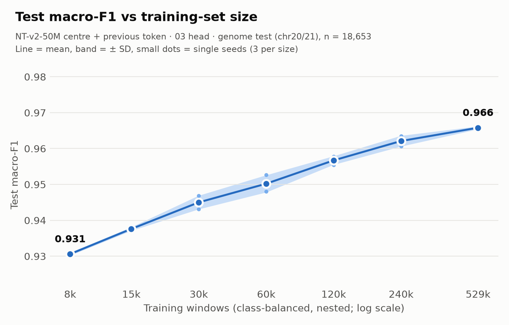
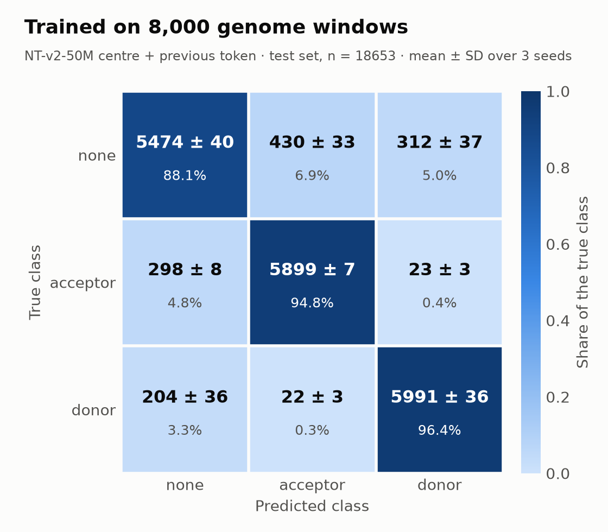
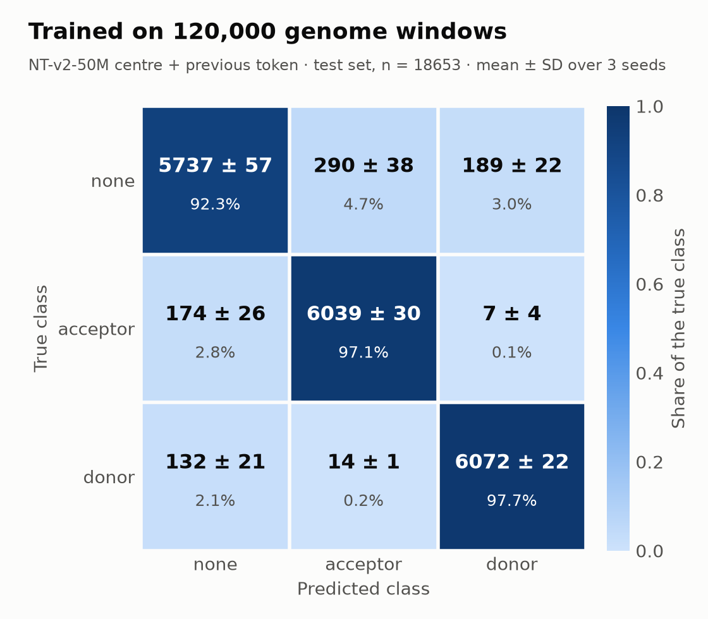
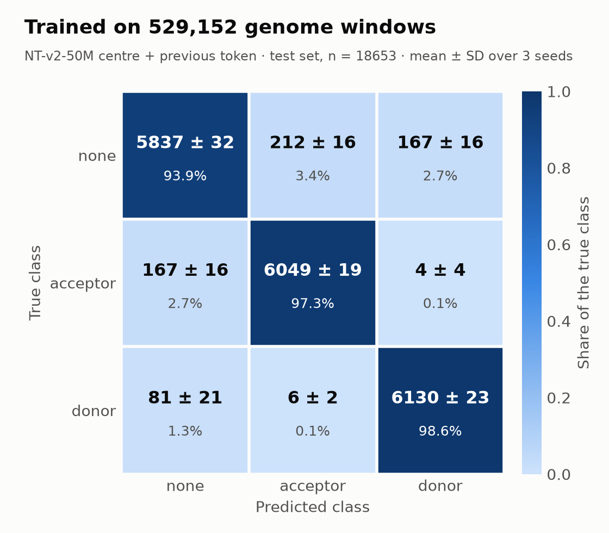

# Learning curve: does more training data help?

_Made by `scripts/18_learning_curve.py` on 2026-11-26 22:21 UTC; every number below is in `runs.json`._

NT-v2-50M frozen, centre + previous token concatenated (`center_plus_prev_concat`), the head and recipe of `03_train_head.py`. Training windows: nested, class-balanced subsets of the genome dataset's full train split (`16_genome_dataset.py`), up to all of it (529,152 = 3 × the smallest class). Test: the same 18,653 genome test windows (chr20/21) for every head. Mean ± SD over seeds 0, 1, 2, range [min–max] in brackets.

| training windows | test macro-F1 | test accuracy | GT decoys called none | AG decoys called none | epoch chosen |
|---:|---|---|---|---|---|
| 8,000 | 0.931 ± 0.000 [0.930–0.931] | 0.931 ± 0.000 [0.931–0.931] | 0.837 ± 0.020 [0.815–0.851] | 0.746 ± 0.020 [0.729–0.767] | 2, 3, 3 |
| 15,000 | 0.938 ± 0.001 [0.937–0.938] | 0.938 ± 0.000 [0.938–0.938] | 0.832 ± 0.026 [0.806–0.857] | 0.771 ± 0.027 [0.740–0.789] | 3, 3, 3 |
| 30,000 | 0.945 ± 0.002 [0.943–0.947] | 0.945 ± 0.002 [0.944–0.947] | 0.858 ± 0.022 [0.835–0.878] | 0.790 ± 0.018 [0.771–0.808] | 2, 2, 2 |
| 60,000 | 0.950 ± 0.002 [0.948–0.953] | 0.950 ± 0.002 [0.948–0.953] | 0.873 ± 0.006 [0.867–0.879] | 0.818 ± 0.020 [0.801–0.841] | 3, 2, 2 |
| 120,000 | 0.957 ± 0.001 [0.955–0.958] | 0.957 ± 0.001 [0.956–0.958] | 0.891 ± 0.015 [0.874–0.902] | 0.827 ± 0.026 [0.797–0.845] | 2, 4, 3 |
| 240,000 | 0.962 ± 0.002 [0.961–0.964] | 0.962 ± 0.002 [0.961–0.964] | 0.901 ± 0.010 [0.890–0.909] | 0.860 ± 0.010 [0.849–0.868] | 4, 3, 3 |
| 529,152 | 0.966 ± 0.000 [0.965–0.966] | 0.966 ± 0.000 [0.966–0.966] | 0.896 ± 0.011 [0.886–0.908] | 0.872 ± 0.005 [0.868–0.877] | 4, 4, 5 |

Mean test macro-F1: 0.931 at 8,000 windows, 0.957 at 120,000 and 0.966 at 529,152 (+0.009 beyond 120,000). Decoy recall = share of the test set's GT decoys (n = 1,036) or AG decoys (n = 1,036) that the head labels none.

## Confusion matrices

Mean ± SD over the 3 seeds; colour and percentage = share of the true class.

## Recipe

- Embedding: once, for every test window, the 120,000-window default train file and the other 409,192 windows of the full train split, with `10_scan_gene.window_features` (float16, checkpointed every 2,048 windows); stored in `data/emb/<model>/genome/`, apart from splice_sites_all's embeddings. Head input = `pair_features(C, P, "center_plus_prev_concat")` (1024 values).
- Subsets: per seed, a seeded order within each class: first the default file's windows, then the rest of the split, the none class interleaving decoy GT, decoy AG, exon interior and intron interior in proportion within each part. Size n takes the first n/3 of each class, so each set contains the smaller ones and keeps the class balance and the none class's thirds. 120,000 is exactly the default file; the largest size is the whole split cut to 176,384 per class.
- Head: `03_train_head.py` with `--seed s`: stratified 10% validation split (random_state s), StandardScaler on the other 90%, 1024 → 256 → 3, Adam (lr 0.001), batch 128, early stopping on validation loss (patience 20), best epoch restored. To fit in the laptop's memory the inputs are built and standardised in chunks, and the scaler is fit with `partial_fit` on chunks of 120,000 rows (a single chunk, so exactly `fit`, up to 120,000 windows).
- The seed changes the subset, the validation split, the initial weights and the batch order. At the largest size the training windows are the same for every seed.

## Checks and caveats

- Test-set noise: at macro-F1 0.966 on 18,653 windows the binomial standard error is about 0.0013; the seed SD does not include it, since the test set is fixed.
- Decoy recall rests on 1,036 GT and 1,036 AG decoy windows, so its own binomial standard error is about 0.009–0.014; steps smaller than that between neighbouring sizes are noise.
- The genome test set is not the splice_sites_all test set, so these numbers are not directly comparable with the 0.940 of `phase1_summary.md` (see `../genome_head_check.md`).
- Reproduction: the sizes up to 120,000 are the windows of the first version of this curve; 15 of 15 runs give the identical test macro-F1, chosen epoch and confusion matrix (largest macro-F1 change 0.0000).
- Embedding check: 2,000 test windows were also embedded separately by `17_genome_head_check.py`; the head inputs agree to a mean absolute difference of 3.8e-07 (max 0.0039, float16 rounding; mean |value| 0.386).

## Files

- `summary.csv`: the table, machine-readable. `runs.csv`: one row per size and seed.
- `runs.json`: every run in full (per-class metrics, confusion matrix, every negative group, epoch history).
- `learning_curve.png`, `confusion_8000.png`, `confusion_120000.png`, `confusion_529152.png`.
- Heads: `data/emb/<model>/genome/heads/head_n<size>_s<seed>.pt` (03's format; git-ignored).
